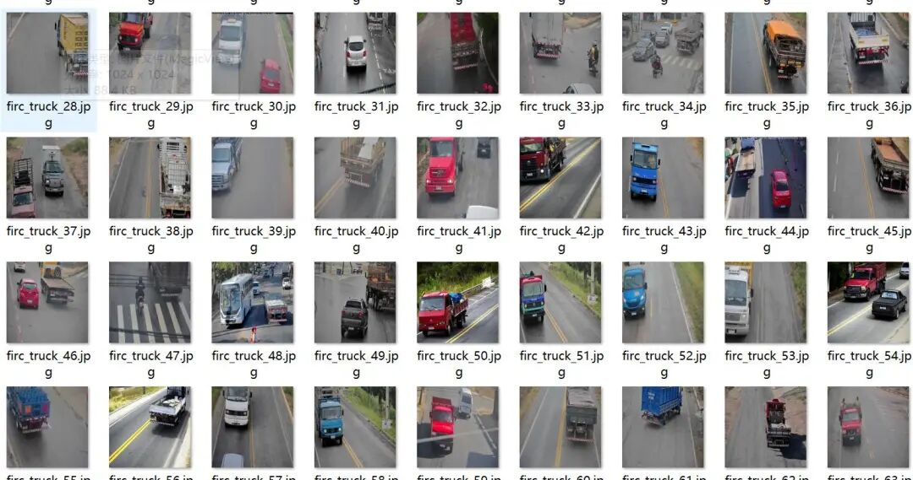
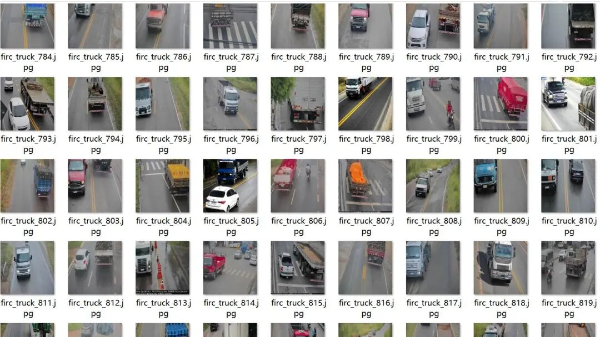
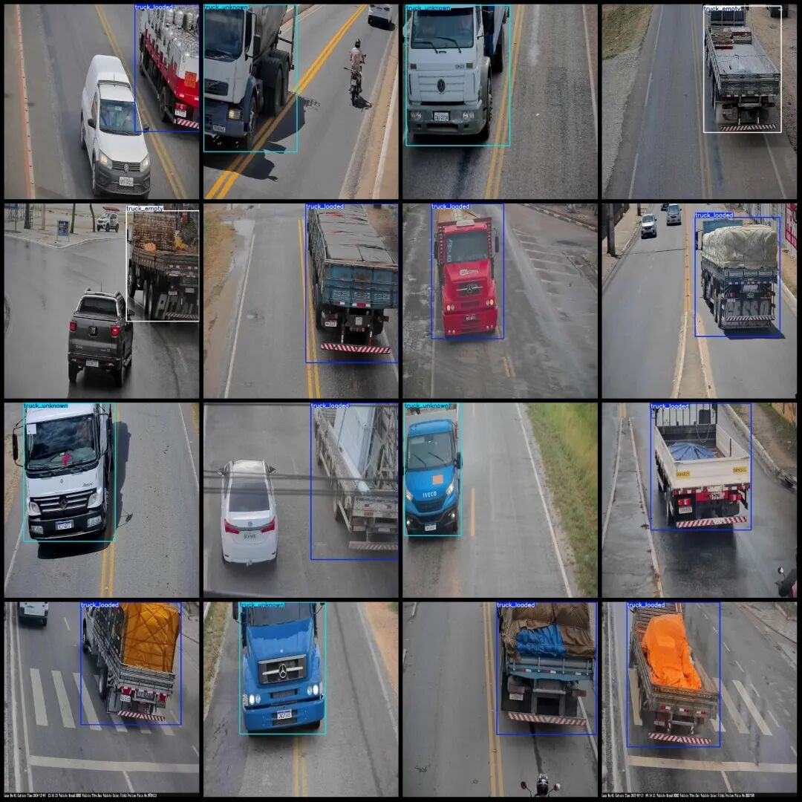
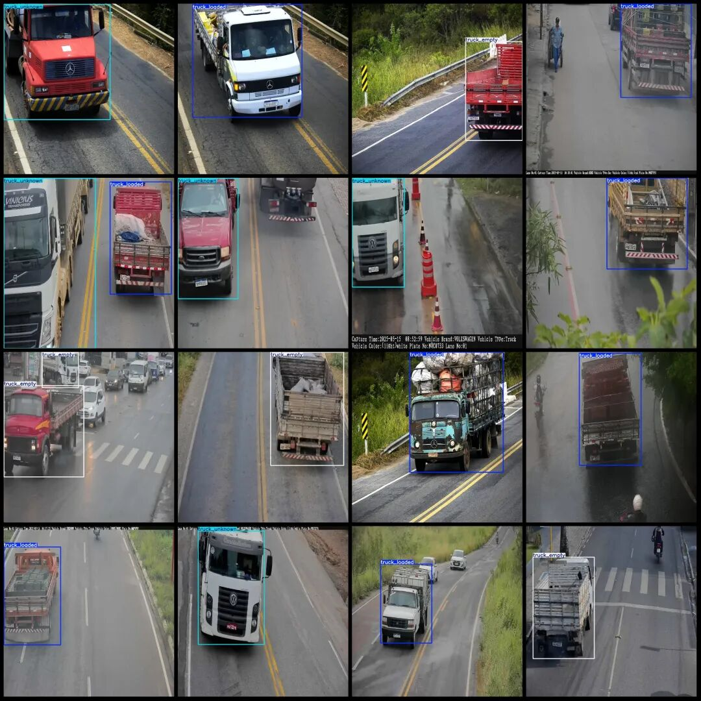

# Intelligent Transport Truck Load State Detection Dataset: VOC+YOLO format with 1053 images in 3 categories

Dataset format: Pascal VOC format + YOLO format (txt file without split path, only contains jpg images and corresponding VOC format xml files and yolo format txt files)

Number of images (number of jpg files): 1053

Number of annotations (number of xml files): 1053

Number of annotations (number of txt files): 1053

Labeling category count: 3

Label category names (Note that the order of yolo format categories does not correspond to this, but is based on the labels folder's classes.txt): ["truck_empty", "truck_loaded", "truck_unknown"]

Number of boxes labeled in each category:

truck_empty (freight box empty) frame count = 250

truck_loaded (Truck is loaded with cargo, possibly full or half-loaded)Frames = 482

truck_unknown (Unknown status) Frame count = 347

Total frames: 1079

Number of images per category:

truck_empty occupies = 248

truck_loaded Number of images held = 478

truck_unknown occupies = 340

Image resolution: 1024x1024

Using labelImg:

Annotation rules: Draw a rectangle around the category.

Important Notice: The dataset does not have separate training, validation, and test sets; you need to partition them yourself.

Special : This dataset does not guarantee the accuracy of the trained models or weight files.

Image Preview:

Annotation example:

## Payment

Here is a pay link on Stripe ( https://buy.stripe.com/3cs8yP7sY87d0vu9AB ). Please contact me lonlonago@foxmail.com after funding $89, and I will send you a complete data files , thank you!

